<!--
_class: title_slide
_paginate: skip
-->

# <!--fit-->COMP 3700A: Contributing to Open Source

### <!--fit-->More adventures with `git`

Charlotte Curtis
October 19, 2026

---

## Housekeeping

- Welcome back! Where were we?
- Do we have notetakers for today's [issues](https://github.com/mru-open-source/f26/issues)?
- How goes part 2?

---

## Today's topics

<div class="columns">
<div>

### Merge conflicts:

- Merge strategies
- Resolving merge conflicts
- Undoing changes

</div>
<div>

### Interactions with upstream:

- Definitions
- Cherry-picking changes
- Git `bisect`
- Submodules and external patches

</div>
</div>

Resources: [git documentation](https://git-scm.com/docs/), [GitKit book](https://runestone.academy/ns/books/published/gitkit2ed/the-gitkit-book.html)

> Some of this may spill over to Wednesday's class

---

## The problem

<div class="columns">



<div>

```python
for i in range(10): # main
    do_something_with(i)
```

```python
for n in range(10): # A
    do_something_with(n)

print("Done")
```

```python
print("Starting loop...")
for i in range(20): # B
    do_something_with(i)
```

</div>
</div>

---

## The solution: 3-way merge

- `git merge` uses one of several [strategies](https://git-scm.com/docs/merge-strategies) (default: **ort**)
- At a high level, the algorithm is as follows:
  1. Find the best common ancestor
  2. Find the changes in each branch
  3. Apply non-conflicting changes, fast-forwarding where possible
  4. Stop and prompt for interaction in case of conflict

---

## Fast-forward vs. merge

<div class="columns">
<div>

### Fast-forward

`git merge A`



- `HEAD` pointer is simply moved
- No new commit is created

</div>
<div>

### Merge

`git merge B`



- Divergent history requires a patch
- A new merge commit is created

</div>
</div>

---

## Conflict? Don't panic!

- You can always `git merge --abort` to go back to how things were
- You can resolve the conflict manually:
  ```python
  <<<<<<< HEAD
  for n in range(10):
      do_something_with(n)
  =======
  print("Starting loop...")
  for i in range(20):
      do_something_with(i)
  >>>>>>> B
  ```
- then `git add` and `git merge --continue`

---

## `reset`, `restore`, `revert`???

| I want to...                             | Use                                 |
| ---------------------------------------- | ----------------------------------- |
| Change the last commit                   | `git commit --amend`                |
| Remove a file from the staging area      | `git restore --staged <file>`       |
| Discard uncommitted changes*             | `git restore <file>`                |
| Rewind log to a previous commit          | `git reset <commit> [--soft/hard*]` |
| Inspect the code a previous commit       | `git checkout <commit>`             |
| Make a new commit undoing a previous one | `git revert <commit>`               |

*Dangerous operation resulting in permanent changes!

---

## Your `reflog` has more info
- Running `git reflog` shows a record of all the actions you've taken *locally*
- You can use this to recover from mistakes
- Example scenario:
  > I used `git reset` to go back to a previous commit, then realized I went back to the wrong one. How do I get back?
- Once you push changes, recovering from mistakes gets trickier

---

<!-- _class: title_slide -->

# <!-- fit --> Interactions with upstream

---

## The many meanings of "upstream"
"Upstream" can refer to:
- The canonical source repo that you forked and connected to with:
  ```bash
  git remote add upstream <url>
  ```
- A dependency for the current project:
  *"This bug seems to be an issue in the upstream GUI toolkit"*
- "Upstream" as a verb, shorthand for "contribute changes to upstream":
  *"Go ahead and upstream your patch"*

---

## Getting changes from upstream (the fork kind)
- We've already talked about [rebasing onto `upstream/main`](../labs/03-git-2.md)
- What if you want a single commit from another branch?
  `git cherry-pick <commit>`
- Also useful for splitting your own work into multiple commits
- As with `merge`, a conflict may occur, which you can resolve and then `git cherry-pick --continue` or choose `git cherry-pick --abort`

---

## Chasing down trouble

---

## Managing dependencies: Submodules

---

## Managing dependencies: custom patches
- Example: [Brave browser](https://github.com/brave/brave-core/tree/master/patches)
